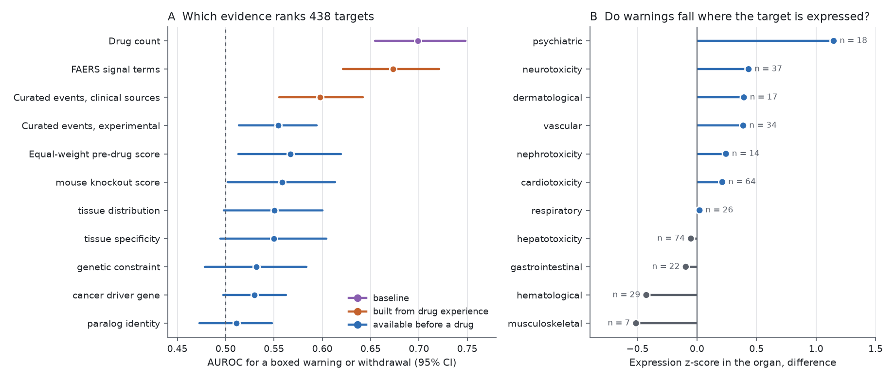

# What predicts a target's safety problems? A scorecard from public data

Target safety assessment combines many kinds of evidence about a drug target into a judgement of risk. This project asks how far public evidence gets: using Open Targets data on 438 human targets of 1,332 approved drugs, it tests whether boxed warnings and withdrawals follow targets at all, which evidence ranks targets with such warnings above the rest, whether learned weights beat equal ones, whether warnings fall in organs where the target is expressed, and whether an LLM can write a target safety rationale in which every statement is traceable to the evidence. Predictions were written before the analysis ([docs/design.md](docs/design.md)); results and verdicts are in [docs/readout.md](docs/readout.md).



## Findings

- Warnings follow targets: two single-target drugs on the same target share their warning status 72.8% of the time, against 60.0% when labels are shuffled (p = 0.0001).
- Evidence available before any drug exists is weak. Genetic constraint, knockout mice, tissue expression, cancer-driver status and paralogs each reach AUROC 0.51 to 0.56, and their equal-weight score adds 0.015 (-0.001 to 0.031) to a baseline that only counts the approved drugs on each target (0.70 alone). Learned weights do worse than equal weights.
- Evidence built from drug experience does better and is partly circular: curated safety events from clinical reviews beat experimental ones by 0.043, and FAERS signal counts (0.67) add nothing beyond drug count.
- Warnings land in organs where the target is expressed (0.15 SD, p = 0.033), clearest for psychiatric, neurological, skin, vascular, kidney and heart warnings and absent for liver, consistent with drug liver injury coming mostly from metabolism rather than the target.
- Claude Opus 5.5 wrote safety rationales for 24 targets from evidence packs; all 222 sentences cited valid evidence IDs and all 264 numbers in factual sentences matched the cited rows (cost $0.66).
- A data check found 55 FAERS adverse-reaction profiles attached to more than one molecule, including clear mismatches (fluvastatin and pravastatin share identical rows).
- Seven of the eight predictions were met; the miss is the added value of pre-drug evidence over drug count.

## Data

Open Targets Platform release 26.09 (CC0): ChEMBL drug molecules, mechanisms and drug warnings; target prioritisation factors, curated target safety events, mouse phenotypes and Reactome pathways; significant FAERS adverse drug reactions from openFDA as processed by Open Targets. GTEx expression for 148 targets comes from the Open Targets API. `scripts/00_get_data.py` downloads the tables (about 37 MB); the data are not included.

## Methods

Approved drugs are mapped from salts to parent molecules and linked to single-protein targets through their mechanisms of action. A target's outcome is whether any of its approved drugs has a boxed warning or was withdrawn. Six Open Targets prioritisation factors are combined by mean percentile rank (equal weights) or by logistic regression (learned weights), always next to the log number of approved drugs, with 5-fold cross-validation grouped by target class and bootstrap intervals over targets. Shared warnings within targets are tested by shuffling labels across drugs; the organ test compares GTEx z-scores in the organ of each toxicity class between targets with and without that warning, shuffling within class. For the LLM part, each target's evidence becomes a list of rows with IDs, Claude returns structured JSON in which every sentence carries the IDs it rests on, and code checks the IDs, every number and every toxicity class against the cited rows.

## Run

```
pip install -r requirements.txt
python scripts/00_get_data.py
python scripts/01_build_cohort.py
python scripts/02_scores.py
python scripts/03_organ_expression.py
python scripts/04_llm_reports.py
python scripts/05_posthoc.py
python scripts/06_verdicts_figure.py
python -m pytest tests
```

Run from the repository root. Step 04 calls the Claude API (24 requests, under $1) and needs `ANTHROPIC_API_KEY` in the environment or in a `.env` file; the stored reports in `results/llm_reports.jsonl` let it re-audit without new calls. Everything else takes about three minutes on a laptop.

## Layout

- `src/tssc/`: cohort and features, statistics, GTEx organ scores, evidence packs and audit
- `scripts/`: the steps above
- `results/`: tables behind every number in the readout, and the 24 reports with their evidence packs
- `tests/`: unit tests on small made-up data

Can Zhang, zhan8639@umn.edu. MIT license.
